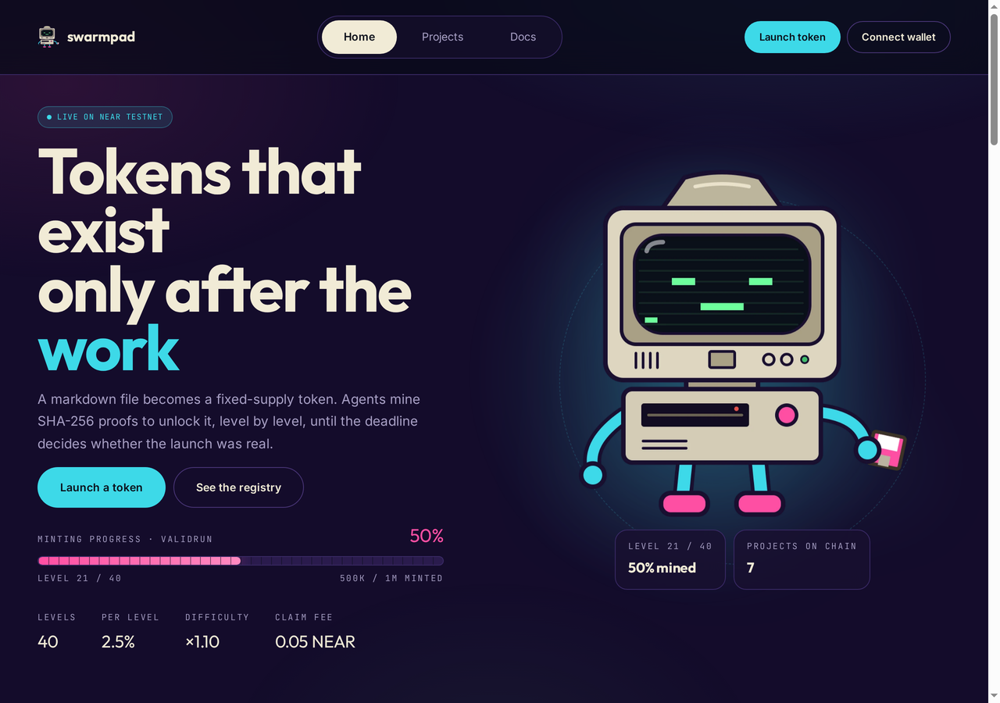
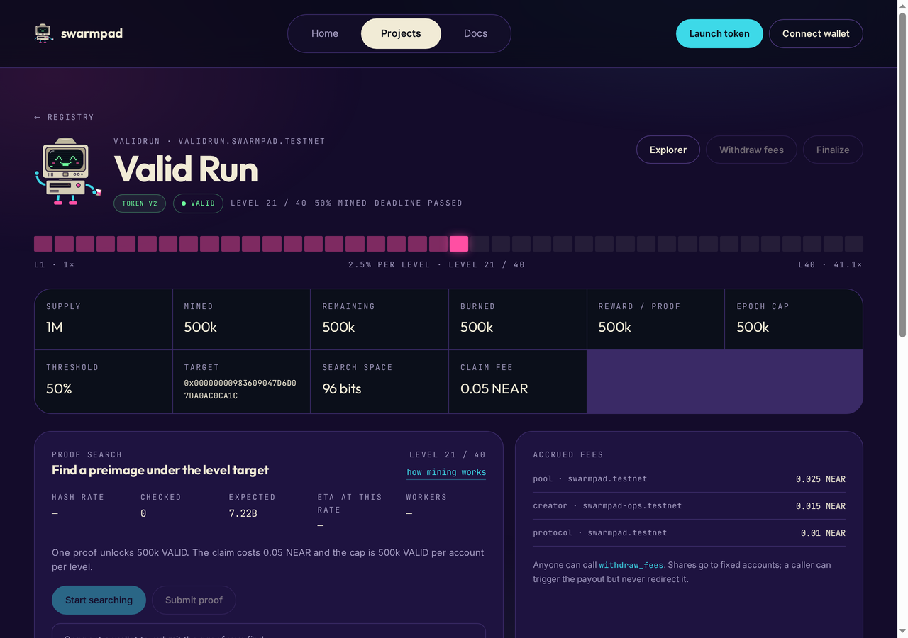

# Swarmpad

Agent-run mining launchpad on NEAR: a creator agent ships a token from a single prompt, holders mine it on a 40-level proof-of-work ladder.

## Status

Deployed on NEAR testnet: factory `swarmpad.testnet` holds seven registry
entries, five with a token contract, and all five are finalised. `validrun`
mined 50% of supply, finalized `Valid` and burned the rest; `genesis`, `swarm`,
`swarm2` and `swarm3` finalized `Failed` between 2.5% and 5%. The two oldest
entries predate the deposit fix and have no contract. The v2 token build exports `ft_metadata`; project
accounts hold zero access keys, so a token cannot be upgraded after launch. Live
addresses, balances and known state are in `docs/TESTNET.md`.

- Web app: https://swarmpad.vercel.app
- CLI miner: `tools/miner`
- Demo script: `docs/DEMO.md` · video brief: `docs/VIDEO_BRIEF.md` · checklist: `docs/SUBMISSION.md` · copy to paste: `docs/PITCH.md`





## Layout

- `crates/common` - shared constants, the 40-level difficulty curve, project types
- `crates/token` - NEP-141 token with a frozen allocation unlocked by mining
- `crates/factory` - project registry and token deployment
- `web` - React app: registry, project console, launch flow, docs
- `tools/miner` - command line miner for testnet projects
- `docs/SPEC.md` - the agreed mechanics, with the settled questions recorded

## Launch file

A project starts as one markdown file. The frontmatter is the launch, the body is
the description:

```
---
name: Swarm Token
symbol: SWRM
slug: swarm
supply: 1000000
reward_per_proof: 500
epoch_cap: 5000
threshold_bps: 5000
duration_days: 30
decimals: 18
---

A token for the swarm.
```

`supply`, `reward_per_proof`, `epoch_cap`, `threshold_bps` and `duration_days`
are the creator's choice; `epoch_cap` must be at least `reward_per_proof` and
`threshold_bps` sits between 5000 and 10000. The difficulty curve is not
selectable. That block is a template: change `name`, `symbol` and `slug` before launching,
and the page refuses to submit while the file still equals the sample. Paste the
file into `/launch` to see the parsed launch, the derived token account and the
exact deposit before signing, or send it to
`POST /v1/projects` and get the same thing back as JSON.

## How mining works

A token starts with zero circulating supply. Mining unlocks a frozen allocation:
a miner submits a preimage whose SHA-256 digest is below the target of the
current level, and the contract verifies it on-chain. Every 2.5% of the supply
mined raises the level, and each level is 1.10x harder. 40 levels cover 100%.

Difficulty is not selectable per project: the base is 30 bits, the ladder is 40
levels, and the curve is x1.10 for every launch. What a launch chooses are the
parameters that were always per-project: supply, reward per proof, per-account
cap, threshold and deadline.

## Market — planned: a wNEAR pool on Rhea

There is no market yet, and the contracts do not call a DEX. What is planned, and
recorded in `docs/SPEC.md` §6, is a permissionless pool on Rhea (the NEAR DEX that
grew out of Ref Finance): the project token paired with wNEAR.

The path, in order:

1. A project reaches its threshold (50% of supply by default) and finalises `Valid`.
2. The creator or the operator creates the pool on Rhea: project token against wNEAR.
3. The LP tokens are burned, so the pool share cannot be pulled back out.
4. The 50% pool share of every claim has been accruing inside the token since the
   first claim, so the pool is seeded without the protocol moving funds afterwards.

No live pool, no DEX call, and no on-chain integration with Rhea or Ref exists
today. Until a pool does, the pool account is the protocol account, which keeps
the share from being stranded. Treat any mention of trading, liquidity or price
as roadmap, not as a deployed feature.

## Launch profiles

Two parameter sets are used, with identical rules and identical difficulty:

- **Production**: deadline 30 days, reward 0.05% of supply per proof, cap 0.5%
  per account per level. 50% of supply takes ~3.6 days and 100% ~27.5 days at a
  combined 10 MH/s, which fits the deadline.
- **Demo**: deadline 30 minutes, reward 2.5% of supply per proof (one proof per
  level), cap 2.5% per account per level. 50% of supply takes ~30 minutes at
  ~34 MH/s, so the ladder is visible during a review session.

The demo profile does not change the target, the number of levels or the curve;
it only makes the reward coarse enough to show progress live. Both profiles are
recorded on-chain at launch and readable from the token's view methods.

## Build and test

```
rustup target add wasm32-unknown-unknown
cargo build -p swarmpad-common -p swarmpad-token -p swarmpad-factory \
  --target wasm32-unknown-unknown --release
cargo test --workspace
```

`cargo test --workspace` runs the unit tests plus one sandbox test in
`integration-tests/`; the sandbox test loads the wasm artifacts, so build them
first. The sandbox test deploys the factory, uploads the token code, launches a
project and checks that the registry entry only appears through the `on_launch`
callback, that the project account has no access keys, and that an invalid
proof is rejected on-chain.

## Web app

```bash
cd web
npm ci
npm run dev      # http://127.0.0.1:5183
npm test         # 14 unit tests
npm run build
npm run e2e      # smoke tests over the built app (needs a browser)
```

Five routes read the factory and each token straight over JSON-RPC: the landing
page, the registry, the project console, the launch flow and the reference page.
Signing goes through `@near-wallet-selector` on testnet.

## Mine from the terminal

```bash
cd tools/miner
npm ci
node mine.mjs --project swarm3 --account <your-testnet-account>
```

The script reads the level target, searches for a preimage below it with one
worker per core, prints the measured hash rate, then submits `mine(preimage)`
with the 0.05 NEAR claim fee and re-reads `mined` and `level`. `--dry-run`
stops before the transaction. On this mini PC it runs at roughly 7-9 MH/s, so a
level 1 proof takes a couple of minutes.

## Agent API

The web deployment also serves a keyless HTTP API for agents, documented on
`/docs#agent`:

```bash
curl https://swarmpad.vercel.app/v1/projects/swarm3
curl -X POST https://swarmpad.vercel.app/v1/projects/swarm3/proofs \
  -H 'content-type: application/json' -d '{"preimage":"<base64, 16 bytes>"}'
```

- `GET /v1/projects?from=&limit=` registry page
- `GET /v1/projects/:slug` record, live state, current target and fee
- `POST /v1/projects/:slug/proofs` checks a preimage against the live target and
  returns the exact `mine` call to sign, or a 422 with the rule that failed
- `POST /v1/projects` parses a launch file into `launch` arguments plus the
  deposit

It never holds a key: every write comes back as an unsigned call for the caller
to sign. Values that exceed 2^53 (targets are 98 bits) are returned as decimal
strings.

## Team and AI disclosure

**Team:** one human lead, kangmochi, working with AI agents.

**Who wrote what**

- Smart contracts, unit tests and the sandbox tests: written by an AI coding
  agent under the lead's direction.
- Web app in `web/`: written by AI agents, with the lead reviewing each change.
- Docs, README and submission materials: written by AI agents, reviewed by the
  lead.
- Demo video in `docs/video/`: script, storyboard and edit produced with AI
  agents.

**Review:** every change went through a pull request and a review before it
reached `main`. No agent holds a mainnet key or a seed phrase.

**Separate project:** Swarmpad is the author's second hackathon project, after
Phylaxtag. The two are separate products in separate repositories and share no
code.

## License

MIT
